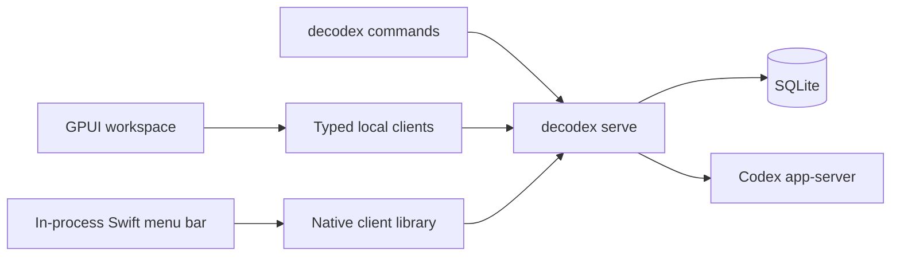

# Runtime Architecture

## Process and state ownership

The current service entrypoint is **`decodex serve`**, from `apps/decodex-cli`. There is no active `apps/decodexd` workspace member or packaged `decodexd` helper. The same executable supplies short-lived CLI commands.

The service owns the local protocol listener, SQLite product state, credentials, account routing and observations, process generations, provider attempts, conversation bindings, Agent coordination, and explicit external effects. The fixed database is `~/.decodex/server/decodex.sqlite3`. Clients do not open the database or auth files as a fallback.



## Application and bundle

`Decodex.app` is the macOS GUI. It contains `decodex-gpui`, signed `Contents/Helpers/decodex`, a native-client FFI library, and `libDecodexMenuBar.dylib`. The menu bar and attached glass controls belong to the same app process. They are not extra apps or state owners.

For local profiles, the app supervises its bundled helper with `serve --parent-fd`. The local service boundary prevents a second owner from replacing an existing service. Typed clients reject incompatible protocol versions instead of opening product storage directly. Closing the main window differs from quitting: the former preserves the running app; quitting retires only its owned service.

The GUI installer links the user CLI to the bundled helper. The standalone service installer supplies a regular executable instead. These are alternative installation modes.

## Native runtime and coordination

Codex app-server owns provider threads and execution. Decodex adds durable work relationships and protocol projections. Agent shares a retained account-bound process across its related work; ordinary conversation sessions keep their own runtime/account bindings. Native child approvals resolve through verified ancestry. Account routing, subscription usage, Reset Card redemption, and weekly activation stay service-owned.

Decodex resolves child requests through the verified native parent chain. The integration does not maintain a second child-admission lifecycle.

Retired repository/GitHub effect orchestration does not return through a wiki update. Historical records remain readable; a historical operation shape is not live execution authority.

## Project, Agent and Work boundary

Project and Work are durable business records. A persistent Agent owns one current native conversation and can own several Works. Assistant and Project Lead select responsibilities of existing Agents. `work_read` and `work_manage` expose scoped evidence and atomic decisions. They do not create an execution engine. Native helpers use native spawn, messages, waits and continuation; independent Agents exchange scoped Collaboration Requests through the existing inbox.

The first actual user input can initialize an independent Agent without an Assistant. Native thread metadata is materialized before Project reconciliation. Every independent conversation must attach to the exact process that created or resumed its native thread; a shared account process does not make one Agent the parent of another.

The overview contains Work headers. `work_portfolio` serves selected evidence in digest-checked 8 KiB pages with a 32 MiB ceiling. SQL applies Agent and granted Material scope before the per-category record limit. Guardian observes optional native review records without overriding conversation permissions or business assessment. Private records exclude raw reasoning and preserve explicit missing action associations.

The service initializes the current schema directly. New conversations advertise the canonical tool revision. Ordinary input resumes its retained native context without a context-upgrade journal. Unknown external effects require authoritative readback. Previous history supplies evidence, not input authority. See [coordination](chief-coordination.md) and [local database](../operations/local-database.md).

The current schema retains immutable native child-input receipts. Direct-call attribution remains available. For nested V2 dispatch permitted by native configuration, the receipt joins exact child input with one parent activity and permits recovery without replay. Missing or ambiguous native evidence stays Unknown. V1 nested execution retains its existing native attribution path.

Multiple immutable Agent bindings can share one admitted native process while preserving account and generation fences. Assignment receipts distinguish plaintext proof from native task-name proof. Prepared task names let the runtime recover encrypted assignments through exact native parent metadata, root turns and unique activity. They do not prove the private prompt text or authorize another spawn.

Before sending input to a retained conversation, the runtime reconciles its registered native Project after exact hydration. It assigns only an unassigned conversation and checks the returned identities. Conflicts park the affected Agent while independent input can continue. This keeps the execution directory and permissions; it does not establish official desktop sidebar synchronization. See the [native acceptance boundary](../testing/upstream-acceptance-boundaries.md#project-agent-work-and-global-guardian).

After a completed Guardian review, optional history recovery can read up to 32 same-directory private candidates and five turns per candidate. It verifies the native parent before retaining exposed assistant output. This supports cold resume, where the selected native protocol has no raw-event subscription. Missing records and missing action Review associations remain explicit.

Native memory inspection and retained usage use read-only local queries. The memory adapter reads the already-loaded native thread and preserves native version selection. Collaboration history and usage derive from existing exact source records; they add no executor, acceptance policy or monetary estimate. See [read-only evidence](chief-coordination.md#read-only-collaboration-evidence-and-usage).

Attached branches use the existing prompt-fork journal and persistent Agent records. Native `thread/fork` attaches a completed-turn prefix to the exact source. Decodex retains that source Agent as the local parent and preserves Project, role and provider identity. It does not copy the native Goal or send input during creation. Unknown creation outcomes retain the original receipt for recovery without replay. Attached children expose only their own turns. Source turn IDs retain the reviewed boundary, and native inference still receives the parent context. The retained public workflow requires paginated source history.

The read-only `GetAttachedBranches` query returns the newest 100 retained Decodex receipts for one exact source. It does not adopt external native branches. Native archive observation checks hidden attached conversations through `attachedToThreadId` and verifies the source binding before reporting membership. Incomplete metadata or catalog reads remain unknown. [Retained attached-fork evidence](../../automations/upstream/retained-contracts.json) records the exact artifact and executed regressions separately from historical acceptance.

## Native history and resource lookup

The read-only local `GetItemContext` query uses the existing native history source for an exact Work, thread, turn and item. It reads a bounded same-turn window and native directional continuations. The source is checked before and after the read; a changed source discards the result. The desktop locates an already loaded exact item without this query. For an unloaded item, it presents the bounded result in the main transcript through the existing message and tool renderers. Native item pages have no canonical timeline ordinals and remain separate from the cached ordinary page. A fixed return action restores the prior reading position. This adds no history store or executor.

`GetResourceOwners` checks that the selected exact resource belongs to the current conversation, then calls native `thread/attachmentOwner/list`. Native Codex owns the association store, archive filter and cursors. The current account processes use the same native home, so one admitted catalog read covers that store. Local retained bindings supply account labels. Only an exact current local thread can open directly; other owners remain references; lookup creates no new local conversation or file association.

The conversation header and Menu Bar expose the existing source-bound provider usage estimate. Menu Bar uses the native-client FFI and at most eight recent locally managed conversations. It checks the runtime and thread bindings again before publishing the result. Estimates preserve unknown values and do not supply an account total, billing service or local model price table. See [estimate presentation](../workflows/models-and-settings.md#conversation-cost-estimates).

## Native launch policy

Decodex constructs and attests one fixed app-server argument list. It requests native subagent context defaults, Agent message wakeups, and full-fork prefix preservation. The retained `code_mode_tool_description_first` argument is accepted but is now a removed native feature; current ordering is native-owned. The dotted prefix option preserves the existing `multi_agent_v2` selection; it does not enable multi-agent execution by itself. Code Mode hosting transport stays under native configuration.

The embedded runtime requirement selects the exact component. Development uses a reviewed upstream commit; production selects a qualified official Release. Check the actual component and its generated protocol schema before claiming that an API is available. See [upstream maintenance](../operations/codex-upstream-autopilot.md).

## Startup preflight cleanup

Version and schema preflights reserve one slot in the daemon's bounded cleanup quarantine before the first child starts. `ProcessGuard::Preflight` retains the shared capacity owner and that slot through both preflights. It does not grant account authority or return a `RunnerPermit`. Account-bound processes keep their existing permit.

If immediate cleanup cannot finish, `ProcessGroupOwner` transfers the child, its output pump and the guard to the reaper. The guard remains owned until cleanup completes. Existing queue limits, preflight deadlines and process-group signaling rules still apply. The two-phase profile regression covers cleanup handoff during either version or schema preflight.

## Context defaults

Settings > Agents > Native defaults and Agent preferences > Context defaults expose the same two context features and per-server MCP startup choices. The panel reads the saved user value and the effective project default through the current account-bound app-server. It writes one boolean with the native file path and version from that observation, then reads the result again. It does not store a second preference in SQLite or add a launch argument that forces either setting on.

The same values can be edited in native `config.toml`:

```toml
[features]
async_compaction = true
retain_client_tool_outputs = true
```

`false` explicitly disables a setting. An absent value keeps the native default, which is off for these two experimental features. Project or managed configuration can override a saved user preference. The panel reports both values when they differ. A changed file or source requires a fresh review; an unconfirmed save is not retried automatically.

To set the native async threshold, replace its boolean with the table form:

```toml
[features.async_compaction]
enabled = true
model_async_compact_threshold_percent = 65
```

Changing the On or Off choice preserves an existing threshold table. Defaults apply to new conversations. Loaded conversations keep their configuration; the service does not restart or resume them to apply a preference.

Background compaction prepares a native summary before context fills. Native runtime eligibility and thresholds decide whether work starts. An enabled configuration value does not prove that a running conversation is using background compaction, or that hosted latency or cost improved.

Compatibility tool-output retention selects only Decodex delegation instructions. The producer sends `retain: true` for `work_instruction` while preserving its tool authority. Codex decides whether to keep it under `retain_client_tool_outputs` and its retention budget. Ordinary results, wakes and retries do not all become permanent context. See [Agent coordination](chief-coordination.md#native-contributions-and-independent-collaboration).

The per-server cached-catalog switch saves `mcp_servers.<quoted-server>.startup_readiness` as `catalog` or `connection`. It uses the same file/version write and readback path. Only existing servers in the writable user layer appear; project-only and plugin servers remain managed in Codex. The panel transfers server names and readiness values, without transport credentials. Codex owns cache validation, discovery and live tool execution. The desktop adds no cache, retry policy or global enablement.

## Components and app updates

`decodex-components` owns one per-user component store, package verification and cache repair. The GUI and service embed the same runtime requirement. App startup prepares that component before launching the owned service; preparation does not consume connection retry attempts. Settings > Components shows the selected component, progress, errors and Retry. Optional EGM installation, update and removal use the native Codex plugin lifecycle. Sparkle owns the separate Decodex application update flow in Settings > Updates.

Official Release inputs require an exact tag, canonical OpenAI asset URL, archive SHA-256, executable SHA-256 and generated schema fingerprint. The installer checks the archive before extraction, then verifies signatures, version and protocol evidence. Downloads have three bounded attempts. A verified replacement is published atomically; a failed repair preserves the previous directory, and other versions remain available.

Development keeps [the reviewed source requirement](../../codex-runtime.lock.json). `cargo make prepare-codex` explicitly builds or imports its qualified artifact. The source builder uses the common checked download path, stable Rust and the unchanged upstream Cargo lock. Its extractor refreshes source modification times while retaining the dependency build cache, so historical archive timestamps cannot select stale local objects. The app does not compile Codex.

Development artifacts use the same package verification and installation path. A local receipt binds archive and executable hashes to the fixed source commit and expected schema. CLI, Code Mode helper and any advertised standalone executor must contain the fixed development commit. The source builder signs the advertised executor with its upstream entitlements. The common component verifier requires the advertised helper and verifies its signature; legacy packages without that metadata retain their existing layout. A new artifact becomes selectable only after its installation verifies. Hashes and schema are integrity evidence; affected native regression tests still establish behavior.

The [portable qualification record](../../automations/upstream/qualification.json) binds the current artifact, helper hashes, source checks and native consumer results to their limits. The [retained contract catalog](../../automations/upstream/retained-contracts.json) supplies stable consumer requirements and original qualification limits. The [current router](../../automations/upstream/retained-evidence.json) links the selected runtime evidence. The native automation directory owns detailed receipts and the live review cursor. A source-test launcher that enables private fixture hooks is separate from the production CLI; neither source-test success nor this record establishes installed-app acceptance.

Read the development lock and current qualification for the selected source, artifact and synthetic consumer limits. Keep the selected runtime, source-review cursor and installed binary as separate identities. A workflow or evidence update does not change those identities.

The selected development runtime remains `33d306d4`. Source review through `5be57bedd0` is complete, but that candidate passes 49 of 50 retained native contracts. Cold resume of a fork with its saved provider fails after the configured default changes; the original selected artifact passes the same test. [The compatibility issue](https://github.com/acg-box/decodex/issues/2575) blocks the runtime pin. The completed source review and shared component repair do not qualify the candidate or an installed application.

The separate `retained_project_agent_work.installed_acceptance` entry records the local installed development app, its executable identities and observed behavior. It includes the independent-Agent composer and input-routing repairs. It retains its own limits and does not extend the earlier synthetic native qualification. See [acceptance boundaries](../testing/upstream-acceptance-boundaries.md#project-agent-work-and-global-guardian).

The current qualification retains terminal `modelNotFound` classification through live, stored and cold history without native retries or Decodex capacity retries. It also checks that an explicitly configured model catalog larger than 1 MiB reaches native model discovery. Reusable fixtures belong to `crates/decodex-runtime/tests/native_qualification/`; these synthetic provider cases do not add an account type or a provider setup control.

Native `policyCapacityUnavailable` remains a distinct persisted error. It does not select Decodex overload retries. The local HTTP fixture permits native request retries; those are separate from a Decodex continuation. Native permission checkpoints retain acknowledged approval and reviewer settings through fork and cold resume despite stale turn context. Startup also skips a directory at `.env`. The reusable fixtures qualify these bounded behaviors, not a live provider.

Production staging selects a separate official Release requirement. Release pinning requires the Release to contain the current development baseline, and behavioral qualification must cover retained fixes. An older official Release is not a fallback. Packaging includes the requirement and Sparkle, but no Codex binary or schemas. See [Commands and validation](../operations/commands-and-validation.md).

## Protocol and safety

Clients use same-UID local transport and exact protocol/artifact compatibility. Protocol 4.3 exposes current Project, Agent, Work, Guardian and attached-branch operations. An incompatible client fails explicitly; there is no parallel alias rollout. Publication-instance receipts remain enabled for this generation, including reconnect and idempotent command recovery. Credentials do not enter normal product projections. Revisions and stable command identities guard mutations. An unknown outcome requires authoritative readback, not blind retry.

Diagnostics covers Decodex product storage, local transport and integration failures. The standalone Codex startup-configuration check, its local query and its dedicated qualification helper are retired. Codex owns its app-server self-diagnostics. Ordinary error and warning presentation and user-requested conversation Markdown export remain supported. This retirement does not qualify an installed protocol 4.0 application against the current service.

Native shutdown admission errors use code `-32600` and the structured `serverShuttingDown` reason. An exact-message classification applies only when error data is absent. A classified refusal alone never authorizes replay: callers must establish exact request identity and no prior effects.

The Settings menu-bar preference is durable SQLite state. macOS launch-at-login registration is a distinct platform preference. Window material, focus, animation and local panel visibility remain presentation responsibilities.

## Packaging and verification

Select full Xcode with `xcode-select`; scripts honor an explicit `DEVELOPER_DIR` override. They do not require a fixed Beta path. Rust compilation uses stable. Run:

```sh
cargo +stable test -p decodex-runtime -p decodex-database -p decodex-codex --lib
cargo +stable test -p decodex-gpui --bin decodex-gpui
scripts/macos/test_decodex_app_stage.sh
```

The stage test verifies signed bundle shape, metadata, native ABI compatibility, and a deliberately incompatible fixture. It does not prove microphone permissions, visual quality, or live provider acceptance. See [Commands and validation](../operations/commands-and-validation.md), [Agent coordination](chief-coordination.md), and [Desktop workspace](desktop-workspace.md).
