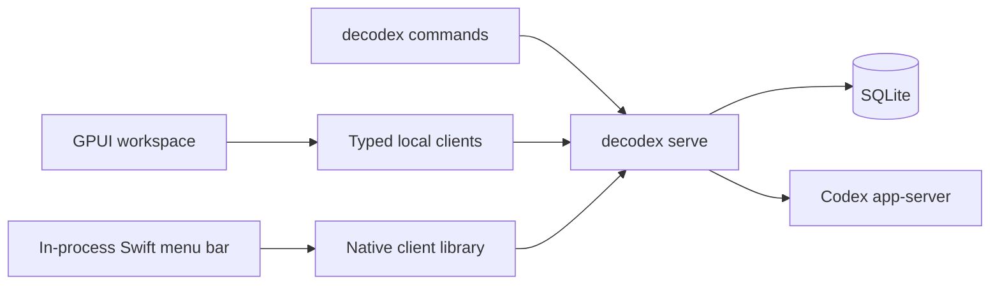

# Runtime Architecture

## Process and state ownership

The current service entrypoint is **`decodex serve`**, from `apps/decodex-cli`. There is no active `apps/decodexd` workspace member or packaged `decodexd` helper. The same executable supplies short-lived CLI commands.

The service owns the local protocol listener, SQLite product state, credentials, account routing and observations, process generations, provider attempts, conversation bindings, Agent coordination, and explicit external effects. The fixed database is `~/.decodex/server/decodex.sqlite3`. Clients do not open the database or auth files as a fallback.



## Application and bundle

`Decodex.app` is the macOS GUI. It contains `decodex-gpui`, signed `Contents/Helpers/decodex`, a native-client FFI library, and `libDecodexMenuBar.dylib`. The menu bar and attached glass controls belong to the same app process. They are not extra apps or state owners.

For local profiles, the app supervises its bundled helper with `serve --parent-fd`. The local service boundary prevents a second owner from replacing an existing service. Typed clients reject incompatible protocol versions instead of opening product storage directly. Closing the main window differs from quitting: the former preserves the running app; quitting retires only its owned service.

The GUI installer links the user CLI to the bundled helper. The standalone service installer supplies a regular executable instead. These are alternative installation modes.

## Native runtime and coordination

Codex app-server owns provider threads and execution. Decodex adds durable work relationships and protocol projections. Agent shares a retained account-bound process across its related work; ordinary conversation sessions keep their own runtime/account bindings. Historical Program aggregates are a read-only compatibility surface, not a restored execution lane. Native child approvals resolve through verified ancestry. Account routing, subscription usage, Reset Card redemption, and weekly activation stay service-owned.

Retired repository/GitHub effect orchestration does not return through a wiki update. Historical records remain readable; a historical operation shape is not live execution authority.

## Native launch policy

Decodex constructs and attests one fixed app-server argument list. It enables native tool-description-first ordering, native subagent context defaults, and full-fork prefix preservation. The dotted prefix option preserves the existing `multi_agent_v2` selection; it does not enable multi-agent execution by itself. Code Mode hosting transport stays under native configuration.

The embedded runtime requirement selects the exact component. Development uses a reviewed upstream commit; production selects a qualified official Release. Check the actual component and its generated protocol schema before claiming that an API is available. See [upstream maintenance](../operations/codex-upstream-autopilot.md).

## Components and app updates

`decodex-components` owns one per-user component store, package verification and cache repair. The GUI and service embed the same runtime requirement. App startup prepares that component before launching the owned service; preparation does not consume connection retry attempts. Settings > Updates & Components shows the selected component, progress, errors and Retry. Sparkle owns the separate Decodex application update flow.

Official Release inputs require an exact tag, canonical OpenAI asset URL, archive SHA-256, executable SHA-256 and generated schema fingerprint. The installer checks the archive before extraction, then verifies signatures, version and protocol evidence. Downloads have three bounded attempts. A verified replacement is published atomically; a failed repair preserves the previous directory, and other versions remain available.

Development keeps [the reviewed source requirement](../../codex-runtime.lock.json). `cargo make prepare-codex` explicitly builds or imports its qualified artifact. The source builder uses the common checked download path, stable Rust and the unchanged upstream Cargo lock. Its extractor refreshes source modification times while retaining the dependency build cache, so historical archive timestamps cannot select stale local objects. The app does not compile Codex.

Development artifacts use the same package verification and installation path. A local receipt binds archive and executable hashes to the fixed source commit and expected schema. CLI and Code Mode helper commit checks reject a different revision. A new artifact becomes selectable only after its installation verifies. Hashes and schema are integrity evidence; affected native regression tests still establish behavior.

Production staging selects a separate official Release requirement. Release pinning requires the Release to contain the current development baseline, and behavioral qualification must cover retained fixes. An older official Release is not a fallback. Packaging includes the requirement and Sparkle, but no Codex binary or schemas. See [Commands and validation](../operations/commands-and-validation.md).

## Protocol and safety

Clients use same-UID local transport and exact protocol/artifact compatibility. Credentials do not enter normal product projections. Revisions and stable command identities guard mutations. An unknown outcome requires authoritative readback, not blind retry.

Native shutdown admission errors use code `-32600` and the structured `serverShuttingDown` reason. The older exact-message fallback applies only when error data is absent. A classified refusal alone never authorizes replay: callers must establish exact request identity and no prior effects.

The Settings menu-bar preference is durable SQLite state. macOS launch-at-login registration is a distinct platform preference. Window material, focus, animation and local panel visibility remain presentation responsibilities.

## Packaging and verification

Select full Xcode with `xcode-select`; scripts honor an explicit `DEVELOPER_DIR` override. They do not require a fixed Beta path. Rust compilation uses stable. Run:

```sh
cargo +stable test -p decodex-runtime -p decodex-database -p decodex-codex --lib
cargo +stable test -p decodex-gpui --bin decodex-gpui
scripts/macos/test_decodex_app_stage.sh
```

The stage test verifies signed bundle shape, metadata, native ABI compatibility, and a deliberately incompatible fixture. It does not prove microphone permissions, visual quality, or live provider acceptance. See [Commands and validation](../operations/commands-and-validation.md), [Agent coordination](chief-coordination.md), and [Desktop workspace](desktop-workspace.md).
