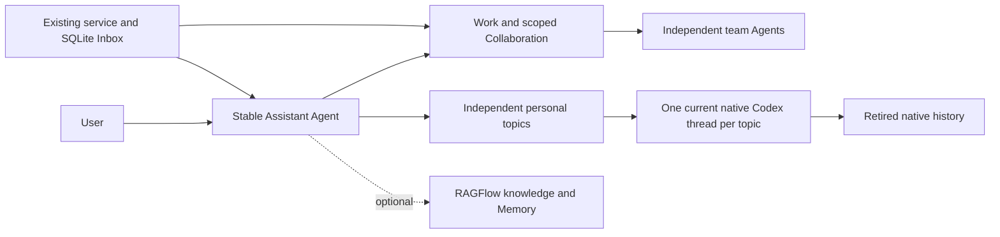

# Assistant delegation, memory and context lifecycle

## Status and purpose

The Assistant lifecycle is implemented in the current source. Assistant is built in and available by default. The sidebar opens its persistent personal identity and initializes it on first use. The same Assistant can have several independent conversation topics. The user can also select an existing Agent in Work. It accepts continuing instructions, manages lightweight teams and delegated Agents, registers independent duties, connects to optional RAGFlow Memory and renews native context within each topic. It has no built-in project patrol or monitoring assignment. The user can work directly with any other Agent or Project Lead.

Native Codex remains the executor. Decodex retains identity, relationships, Work and delivery records. The implementation adds no second executor, mandatory management hierarchy, parallel task ledger, memory framework or database migration. Local protocol is 4.9 and the current SQLite schema is 61. The application accepts one current state format; it has no automatic upgrade chain.



## Owners

| Owner | Responsibility |
| --- | --- |
| User | Delegate outcomes and duties, set limits, select Memory and chat import, and answer decisions that require the user. |
| Assistant | Perform simple work, select collaborators, arrange contributions, assess Results and report material outcomes or blockers. |
| Work owner | Retain one accountable owner, current requirements, Materials and explicit assessment. |
| Decodex service and SQLite | Retain Agent identity, mandate, teams, wakes, current native binding and exact operation receipts. |
| Codex | Execute threads, tools, native Subagents, Goals, permissions, approvals and compaction. |
| Optional RAGFlow component | Install and configure the local service, retrieve selected knowledge and extract or retrieve authorized long-term Memory. |
| Desktop | Keep each personal topic's chat, draft, reading state and source-linked history. |

Team membership does not grant private-chat access, approval authority or a shared execution sandbox. RAGFlow results are evidence and cannot authorize execution.

## Select and configure the Assistant

Use the hover plus beside **Assistant** in the sidebar, or choose **New Assistant topic** from **Search and commands (Command-K)**. The personal Assistant is always available and has no Enable control or optional component row. First use saves an idle personal Agent and its role in one transaction. It does not manufacture a first user message or submit model work. Give continuing instructions and team or duty requests in chat; defaults handle context renewal. RAGFlow is the optional component in Settings > Components.

First setup seeds the existing per-Agent next-message choices from the displayed model and effort when available, the new-conversation permission default and the shared speed preference. The first actual message carries those choices through the configured-input path. Existing Agent settings and saved drafts remain independent.

The CLI uses the same typed service commands:

```sh
decodex agent assistant-role --agent-id personal
decodex agent assistant --agent-id personal --command-file /absolute/path/command.json --idempotency-key exact-command-key
```

Assistant tools are `assistant_read`, `assistant_manage` and `assistant_memory`. New native contexts receive these declarations and Assistant-specific instructions only for the canonical Assistant and its explicitly recorded personal topics. Ordinary project Agents keep the common Work and coordination surfaces. Back-end checks reject calls by other Agents. Existing native contexts retain their original declarations; this update does not replace project conversations or discard history.

## Independent personal topics

**New Assistant topic** first reopens an unstarted personal draft, preserving its input. Repeated clicks do not add empty topics. If no eligible draft exists, the control creates an idle topic through the existing action described below. A local topic record is not a native conversation. Unstarted topics use their ordinary topic label without a Draft suffix. An empty canonical identity stays hidden from conversation lists unless it is currently selected, has retained input or has a native binding.

Creating another topic uses `CreateAssistantTopic` to record a local idle topic. Creation records membership with the topic in one database transaction. It sends no message and makes no model request. The first submitted input starts a fresh native conversation through normal admission. It does not fork another topic or copy its dialogue.

One canonical Assistant owns the mandate, configuration, teams, wakes and RAGFlow agent scope. Each topic resolves that owner through explicit recorded membership. Prefixes, titles and project membership do not establish this role. Personal topic aliases are excluded from the public Agent catalog and cannot be promoted into independent Assistants or used as team members. Project Agents therefore receive neither personal tool declarations nor automatic personal recall.

Each topic retains its actual conversation identity for delivered user decisions, command receipts, drafts, native contexts and history. A user receipt from another topic cannot authorize a local action. Configuration changes request safe context refresh for recorded personal topics. Automatic Memory export selects at most one eligible exchange across the canonical conversation and active topics per job, retains its actual native session and turn, and writes under the shared canonical Memory agent scope.

`assistant_read` includes global Work headers so the personal Assistant can locate ongoing outcomes. Detailed evidence, contributions, assessment and mutation remain with the original Work conversation and its existing scoped commands. Shared personal identity does not grant another Agent's private-chat access or transfer delivery authority.

## Delegate Agents and teams

Use an independent persistent Agent for a continuing collaborator with its own conversation. Use native Subagents for bounded contributions. `create_agent` retains the creating Assistant, stable command identity and exact delivered user decision. The initial `assistant_instruction` is application-origin input, not a fabricated user message. It uses normal native admission and independent ownership, with no mandatory parent link.

A delivered initial instruction can establish that recipient's own initial Work through its linked original user decision. Repeating the exact creation command reuses its recorded identity. A missing native acknowledgment never authorizes another creation.

A team contains a stable ID, name, optional Project and existing member Agents with responsibilities. One Agent can join several teams. `put_team` creates or replaces membership; `remove_team` removes the relationship and leaves existing Work and conversations available.

Assign outcome contributions through existing Work and Collaboration Requests. The requesting Work owner supplies scoped requirements and Materials; Results return through the existing Inbox. A recipient's ordinary conversation turn is not automatic Work acceptance. The Assistant assesses evidence and requests repair through the same request when needed. Creating a continuing role alone does not subscribe the Assistant to every private conversation turn.

## Continuing duties and background behavior

`set_mandate` saves enduring instructions with an exact delivered user decision and requests a fresh context at the next safe input boundary, so later turns receive the current instructions. `schedule` registers a wake with an independent stable identity, instruction, decision reference and future Unix microsecond timestamp. A recurring interval is at least 60 seconds. `cancel_wake` cancels that duty alone. There is no default patrol.

The existing 15-second service tick queues due entries in the durable Inbox and advances their own timestamps atomically. Missed recurring occurrences coalesce into one wake. They do not overwrite another duty's next check. An idle Assistant waits without repeated inference. User input and scoped Collaboration results use existing delivery and ownership rules.

Shared instructions request notifications for material changes, outcomes, failures or required user decisions unless the user requested routine reports. This is an Agent instruction, not a separate deterministic notification classifier.

Execution requires the service and machine to be available. A restart restores saved duties; it does not promise uninterrupted cloud execution. Explicit Agent archive cancels future duties. Retiring an old context during renewal does not run that archive cleanup.

## Independent project duties

An ordinary persistent Agent can own continuing duties without the personal
Assistant role. The direct user commands `decodex agent schedule` and
`decodex agent cancel-schedule` use the same typed service boundary as other
Agent commands. Each duty has its own identity and instruction. The Agent
snapshot exposes its saved `scheduled_wakes`.

The existing service tick uses the durable Inbox journal. It queues an occurrence
and advances that duty in one transaction. A recurring duty retains its selected
UTC cadence: missed intervals produce one occurrence, then the next future time
on that cadence. Repeating the same save receipt cannot restore an old due time.
Cancellation leaves an already admitted turn intact. Agent archive cancels its
future duties; a normal service restart retains them.

Delivery uses native automation input and separate application-tool context. It
does not manufacture a user message or grant personal Memory access. The machine
and service must be available. [Codex upstream maintenance](../operations/codex-upstream-autopilot.md)
uses this independent owner, with registration and actual trigger evidence in its
accepted internal handoff.

## Context assembly

The stable Agent has one current native thread. Native compaction still operates within that context. Fresh context is a separate lifetime boundary.

Current turn preparation injects a compact Work directory with identities, requirement revisions, state and request status. `work_read` supplies selected requirements, decisions and evidence before assignment or assessment. Detailed portfolios, tool traces and team transcripts are not injected by default.

A fresh context receives the current mandate, team and wake state, the compact Work directory and up to eight recent original exchanges across recorded native contexts, within a 24 KiB excerpt budget. It reads original native user/final-message records. A previous bootstrap or recursive summary is not the source. Exact earlier history and Result references remain available for detail.

Current requirements, explicit user corrections and durable action receipts take precedence over recollection. Work state, approvals, actions, scheduled duties and import status remain in their existing native or product owners; semantic Memory does not replace them.

## Fresh-context renewal

The default interval is 24 completed native turns. A nonzero interval also permits renewal at 80 percent of the observed native context window. Zero disables periodic and pressure-based renewal. An explicit `refresh_context`, saved mandate or saved configuration requests renewal independently. These are initial policy values, not an optimal threshold established by long-conversation benchmarks.

Renewal runs before the next ordinary input at a safe boundary:

1. Check local idle dispatch and native idle state. Wait for approvals, questions, claimed delivery, pending retry, live voice, an unfinished native Goal or live native children to release their current owner. Exact question answers and edited canonical inputs remain with their existing thread.
2. Read necessary original dialogue and preserve the effective model, provider, effort, service tier and native permission profile. An unsupported anonymous permission policy defers renewal instead of changing it.
3. Save one creation intent, bootstrap and timeline offset in the Inbox journal before `thread/start`. Start a clean native thread with `sessionStartSource=clear`; do not fork the old context.
4. Save the acknowledged native ID before naming or dependent reads. Apply the external-memory policy when selected. Name and persist that exact native context.
5. Atomically change the stable Agent's current binding and append the existing thread-revision relationship. Preserve queued input, Work and duties. Restore normal native process ownership and settings observations.
6. Deliver saved input through the existing dispatch fence, inject the source-backed bootstrap once, and unsubscribe the old native context. Keep its history and original turn/item identities.

A creation with a missing reply is reconciled by its exact recorded native source marker among loaded threads. Only one exact match can be adopted. No match leaves the old context usable and the receipt pending; it does not authorize a second creation. A process loss before the native thread becomes recoverable can therefore require attention. Independent team members continue under their own native ownership.

## Desktop continuity

The desktop recognizes a verified successor binding for the same Assistant and retains a usable editor, loaded rows and reading state. Saved draft ownership follows the recorded Assistant lineage, including after restart. Submitted commands and history references keep their exact native identities. It updates older-page cursors and uses cumulative logical positions with exact native source threads. The host joins bounded native pages across the recorded lineage; it does not copy the full transcript into a second history store. The wire decoder reads decimal source-position keys through the tagged JSON response, so a nonempty source map does not turn a valid page into a history failure.

Retired-context rows are read-only. Native source IDs remain exact for detail, media, Results and references. Normal context renewal adds no confirmation or handoff report. A pending context confirmation uses shared inline feedback in Work. External import status stays with the RAGFlow component. Side chats keep their separate inherited-context semantics.

## Delete an Assistant conversation

Archive preserves conversation history and cancels its unsent interactions. Delete removes the current native conversation and its recorded earlier contexts, then purges local conversation text and desktop drafts. Partial native deletion remains visible in Archive until a retry completes.

Conversation rows expose fixed trailing archive and delete symbols. The first delete click arms the same symbol with a red nudge; the second confirms. Escape or an outside click cancels. Archive requires the exact current idle binding and verifies the native archived state before local retirement. Active-conversation deletion archives that source first, then uses the existing durable deletion plan. A retry with a recorded deletion plan resumes that plan instead of repeating native creation or model work. An unused local topic uses the existing discard operation. Clearing the unstarted canonical draft keeps its personal identity and configuration.

The personal Assistant identity, saved configuration and learned RAGFlow Memory survive conversation deletion. Deleting the canonical conversation returns it to an empty idle conversation with no native binding. Deleting a separate topic removes its active membership. If independent Work still references that topic's owner identity, retain only the content-free canonical membership marked retired. It remains absent from active topic and public Agent lists; its old title, instructions and chat content are purged. Work references keep their original identity. An unused empty topic can be discarded completely.

The next user input can start a fresh context. Conversation deletion neither clears Memory nor reimports the deleted conversation. Use the separate scoped Memory controls to remove learned content.

Deletion does not change the renewal policy above. Continuous Assistant identity and Memory do not require one permanent native thread.

## Optional RAGFlow knowledge and Memory

Choose Install for RAGFlow in Settings > Components. Decodex prepares the official nightly service and compatible Infinity 0.7.4. Docker must be running. A private per-user Compose project owns RAGFlow, Infinity, MySQL, MinIO, Kvrocks, NATS and their data volumes; only the RAGFlow API is published, on loopback. ARM64 uses the official Infinity binary and analyzer resources with the required Ubuntu 24.04 runtime. The component installs no model runtime or model weights.

Component operations check that the Docker-compatible engine is running and Docker Compose is available before changing the installation. Missing prerequisites use the shared inline notice. The App does not install or launch the container runtime. Installation creates the private account and opens setup when no models are saved. Expanding RAGFlow shows the saved model summary and an explicit Edit action, or Set up models when setup is incomplete. The editor has four fields: one shared OpenAI-compatible Base URL, an optional API key, an extraction model ID and an embedding model ID. Empty required values disable Save. Complete input receives validation on explicit submission; edits refresh the form and clear the old error. Collapse retains the draft. Cancel discards it and returns to the expanded summary. Save asks RAGFlow to verify both exact models before updating provider instances and defaults. The embedding instance identity stays stable. Setup creates or recovers the dedicated Memory by its stable name and publishes the derived connection through Assistant Configure. It initializes the idle Assistant if needed and sends no chat content. No separate Connect action or manual service-account configuration is required.

Model keys remain private. The saved summary shows key status only, and the editor does not refill the key. A blank key retains the saved extraction connection key only while the shared Base URL stays unchanged. Both model choices use that connection. A service that needs no key can use an empty value. Loopback URLs become host.docker.internal when RAGFlow calls the host, while the UI retains the entered address. A Memory with messages keeps its embedding model and endpoint so its index remains valid. Failed verification retains the previous saved configuration.

RAGFlow shares the existing component lifecycle buttons, version metadata, disclosure, busy state and inline feedback. The version row retains the complete server-reported value. The receipt and UI use the original server version directly. Update retains model configuration, credentials, saved data and the automatic-learning choice. Uninstall stops only the owned project, clears its Assistant connection and retains volumes for reinstall. The private installation receipt preserves the project, account and model settings, so service setup can resume through Update. Model setup failures retry through Save. The Automatic learning switch remains independent of model editing and is available when Memory is ready. New Memory connections enable learning; Update preserves an existing saved choice, including an opt-out.

Reset Memory is available for the configured managed Memory. It first displays an inline confirmation bound to the exact selected Memory. Confirming checks the private installation receipt, service origin, credential reference and local Assistant namespace, removes only that Memory through the native API, and initializes an empty replacement with the saved extraction and embedding choices. It keeps chat history, model settings, credentials, explicit knowledge datasets and service volumes. Successful reset preserves the current automatic-learning choice and starts a new export boundary. It does not replay old conversations or change unrelated Memories.

After the delete succeeds, the component removes the old Memory identity from its private receipt before creating the replacement. A failed creation leaves models and credentials available; Edit and Save initializes Memory again. A later explicit reset can reconcile a missing response to the exact confirmed delete. Other missing-resource responses remain errors. The UI binds confirmation to the reviewed Memory and rejects a changed target.

Reset is a logical Memory replacement, not in-place reindexing or a physical storage-erasure guarantee. It uses the supported Memory API reviewed at [RAGFlow commit 543f57ea9716118356ab8c00674cc05c727ab235](https://github.com/infiniflow/ragflow/blob/543f57ea9716118356ab8c00674cc05c727ab235/internal/service/memory.go). The App does not modify Infinity or database storage directly.

### Development cutover

When a development workspace can discard all previous content, use the offline `clear_development_data` example described in [commands and validation](../operations/commands-and-validation.md). Its plan combines registered native contexts with session metadata that identifies Decodex as the originator. After Decodex stops, it reads each target before deletion, uses native `thread/delete`, resets the managed Memory and clears local conversation, Work, team, duty and execution state. Account credentials, account policy, model defaults and project folder configuration stay in place. Client drafts, blobs, cache, old database backups and logs are removed. This operation submits no native inference turn.

Initialize an empty built-in Assistant with `decodex agent assistant-init --agent-id assistant`. Apply the new managed Memory through the existing typed Configure command with automatic learning enabled. Initialization sends no first user message. An unused Assistant remains visible without a native context or archive lookup. Startup skips it until it has saved execution settings or a pending first input; it does not report a configuration error or block a new project conversation. New project conversations use the current project tool set, and the new Assistant uses its dedicated tool set. This cutover discards old native contexts and their saved tool declarations instead of continuing them. It is an explicit development operation, not an automatic data migration.

### Memory scope and learning

The component saves the generated API key in an origin-bound private component file. The service directory mode is 0700 and private files use mode 0600. Saved Assistant settings and model tools contain only a credential reference. The service requires that origin-bound component credential reference for Memory requests. Redirects are disabled. Components does not ask for raw user, dataset or Memory IDs. Explicit dataset retrieval scopes remain available through the typed configuration command.

Knowledge retrieval and Memory are independent. Empty dataset IDs disable knowledge retrieval; they never select every accessible dataset. Selecting knowledge alone leaves Codex memory policy unchanged. Memory retrieval uses exact Memory, stable Assistant and user scopes across native context changes.

Selecting a Memory shows a reminder and waits for a safe fresh context. New Assistant contexts disable native `memories.generate_memories`, `memories.use_memories` and `features.memories`, and set native memory mode to disabled. Cold resume retains the same policy. The retiring current context also gets disabled memory mode. The change does not edit shared process defaults, unrelated Agents, native compaction or native history, and it does not delete previously generated native memories. The existing native Memory summary view remains an explicit read-only inspection.

New managed Memories use Raw and Semantic types with an Assistant-specific extraction prompt. Semantic extraction includes explicit, durable collaboration preferences, reporting requirements, operating constraints and relevant long-term background. It excludes unrelated general knowledge, Assistant suggestions, acknowledgments, quoted instructions, search questions, temporary acceptance-test markers, credentials, transient task status and claims that an action completed. Content keeps the user's meaning and language, with at most five items in the native Semantic JSON schema. Recovering an existing Memory preserves its saved extraction prompt; setup does not overwrite a custom prompt.

Selecting a new Memory enables automatic learning from completed original user/final-Assistant dialogue. The user can stop future learning with Automatic learning. Existing saved opt-outs survive updates. Learning starts after the saved configuration boundary and does not import older history, reasoning, commentary or tool traces. Exchanges with recognized credentials are skipped. Turns with an explicit remember or forget receipt are excluded to prevent duplicate learning or relearning forgotten content. The worker rechecks that its Assistant and connection are still current before writing. Changing the external instance, Memory or user scope starts a new export boundary. One bounded background job exports at most one eligible exchange per host tick. Export selection matches saved receipt fields for the Memory, native thread and turn. A reserved exchange, including an unknown write, is not selected again and does not block later completed exchanges after restart. The original native history remains available outside RAGFlow's derived memory capacity and forgetting policy. Changing the Memory clears the old import-health notice. A late result from an earlier connection cannot attach its notice to the new configuration.

Before a normal Assistant turn, bounded automatic recall searches the current text within the exact Memory, Assistant and user scope. Queries contain at most 2,048 characters. A five-second timeout bounds the optional read. Up to five results, with at most 1,200 content characters each and original message/session identifiers, enter native untrusted `additionalContext`. Empty results add no memory context. A failed read reports unavailability without blocking the turn or enabling a second memory backend. Native question answers and capacity retries keep their original input paths. This lookup calls no extraction or answer-generation model.

`assistant_memory search` remains available for a follow-up search of Memory or explicitly selected knowledge. `remember` saves the exact delivered user request without enabling all-chat import. `forget` requires an exact message ID, user decision and verified Assistant/user scope. Stable operation receipts prevent automatic resends after unknown effects. RAGFlow's queued response means asynchronous extraction was accepted; it does not prove searchable completion. Timeouts, transport failures and nonzero business codes remain visible and do not enable native-memory fallback.

Managed setup currently creates Raw and Semantic Memory. Episodic and Procedural extraction, personal-document ingestion, Wiki compilation and graph retrieval are not enabled by this change. Personal memory belongs to the selected Assistant and user; it is not automatically passed to project Agents.

See the [official HTTP API](https://ragflow.io/docs/v1.0.0-rc3/http_api_reference) for retrieval, Memory messages and asynchronous import semantics.

## Verification and limits

Database fixtures cover team reuse, independent wakes and archive cancellation, exact delegated creation and authority, pending-input preservation, immutable context receipts and unknown/queued imports across restart. The loopback HTTP fixture checks exact retrieval scopes and rejects an HTTP-success response with a failing business code. HTTP Memory setup fixtures cover default models, recovery after a lost creation reply, origin-bound private credential files and missing-model failure without publishing a Memory credential. Managed-service fixtures check that unavailable container prerequisites leave storage unchanged and do not pull images or start services. They also check loopback-only API exposure, absence of a model runtime and model volume, custom endpoint paths and names, loopback translation, private receipts and an Uninstall command scoped to the owned project without volume removal. The model editor fixtures check blank saved-key fields, same-endpoint key retention, source invalidation, draft preservation, empty-submit blocking, explicit URL validation and input-driven form updates. Shared component UI tests cover installed readback, busy controls, disclosure and feedback. The idle setup fixture verifies role selection and retry without creating a first user event.

Reset fixtures cover exact-target deletion, namespace rejection, retained credentials and model choices, failed replacement without a stale Memory ID, and missing-resource handling. Desktop interaction fixtures cover Edit after Save, Cancel to the saved summary, disclosure without implicit editing, reset confirmation and cancellation, and rejection of a changed confirmation target. Database fixtures clear stale health and reject a late import result from the previous Memory. These fixtures do not clear a live user Memory.

The isolated native test `installed_assistant_renews_fresh_contexts_with_original_dialogue_and_isolated_memory` uses the explicit `DECODEX_TEST_CODEX_BINARY`. The [current qualification](../../automations/upstream/qualification.json) identifies the selected development runtime and exact artifact. It checks three successive fresh contexts, original dialogue across their boundaries, no fork ancestry, one model request per user turn, Assistant-specific context and absent native-memory injection. It also checks that unavailable automatic recall reaches the model as bounded untrusted context. Two separate personal topics then start independent fresh contexts with personal tools and no copied earlier dialogue; a project control context has no personal tools. An unrelated control context retains native memory settings. Native schemas were generated from the selected binary; upstream main is not a substitute for installed capability.

Database fixtures check topic creation retries, shared settings, project and team exclusion, actual-topic user authority, complete empty-topic discard and deletion with retained independent Work. The desktop fixture checks separate topic rows and draft preservation during switching.

Desktop tests cover usable drafts across renewal and restart, loaded history, reading state, old source threads and rebased pagination cursors. The wire regression round-trips a nonempty native source map through the tagged timeline response. Locked-input tests keep the shared status centered and retain the draft internally without a second text block. These are source/fixture results, not installed-app visual acceptance or a live RAGFlow server qualification. No real RAGFlow account or credential is required for these checks. Long-duration quality, external extraction quality and machine sleep behavior still need representative operational measurement.

See [commands and validation](../operations/commands-and-validation.md), [Project, Agent and Work](project-agent-work.md), [conversation recovery](../workflows/conversations-and-recovery.md) and [native integration limits](../testing/upstream-acceptance-boundaries.md).

The Assistant history reader excludes internal realtime delegation and intermediate commentary while retaining public exchanges and native turn anchors. A completed voice task therefore does not block later context renewal. An unset native reasoning effort remains inherited when a successor context is created.
