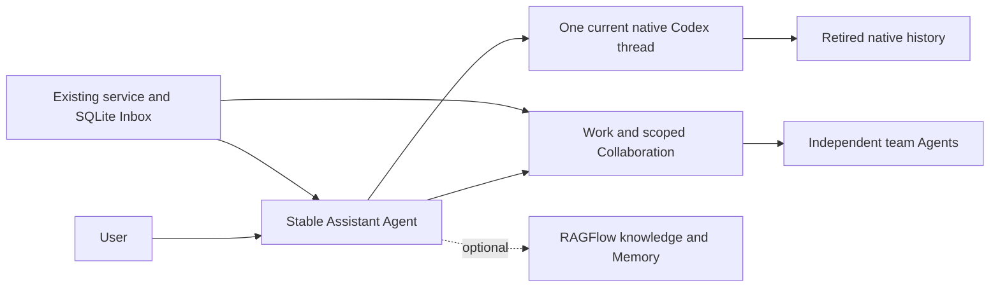

# Assistant delegation, memory and context lifecycle

## Status and purpose

The Assistant lifecycle is implemented in the current source. Assistant is built in and available by default. The sidebar opens its persistent personal Agent and initializes it on first use. The user can also select an existing Agent in Work. It accepts continuing instructions, manages lightweight teams and delegated Agents, registers independent duties, connects to optional RAGFlow Memory and renews native context behind the same chat. It has no built-in project patrol or monitoring assignment. The user can work directly with any other Agent or Project Lead.

Native Codex remains the executor. Decodex retains identity, relationships, Work and delivery records. The implementation adds no second executor, mandatory management hierarchy, parallel task ledger, memory framework or database migration. Local protocol is 4.7 and the current SQLite schema remains 60.



## Owners

| Owner | Responsibility |
| --- | --- |
| User | Delegate outcomes and duties, set limits, select Memory and chat import, and answer decisions that require the user. |
| Assistant | Perform simple work, select collaborators, arrange contributions, assess Results and report material outcomes or blockers. |
| Work owner | Retain one accountable owner, current requirements, Materials and explicit assessment. |
| Decodex service and SQLite | Retain Agent identity, mandate, teams, wakes, current native binding and exact operation receipts. |
| Codex | Execute threads, tools, native Subagents, Goals, permissions, approvals and compaction. |
| Optional RAGFlow component | Install and configure the local service, retrieve selected knowledge and extract or retrieve authorized long-term Memory. |
| Desktop | Keep one Assistant chat, draft, reading state and source-linked history. |

Team membership does not grant private-chat access, approval authority or a shared execution sandbox. RAGFlow results are evidence and cannot authorize execution.

## Select and configure the Assistant

Open **Assistant** in the sidebar. It is always available and has no Enable control or optional component row. First use saves an idle independent Agent and its role in one transaction. It does not manufacture a first user message or submit model work. Existing-Agent selection remains available in Work. Give continuing instructions and team or duty requests in chat; defaults handle context renewal. RAGFlow is the optional component in Settings > Components.

First setup seeds the existing per-Agent next-message choices from the displayed model and effort when available, the new-conversation permission default and the shared speed preference. The first actual message carries those choices through the configured-input path. Existing Agent settings and saved drafts remain independent.

The CLI uses the same typed service commands:

```sh
decodex agent assistant-role --agent-id personal
decodex agent assistant --agent-id personal --command-file /absolute/path/command.json --idempotency-key exact-command-key
```

Agent tools are `assistant_read`, `assistant_manage` and `assistant_memory`. The selected Assistant can use them; a native helper or another persistent Agent cannot acquire this authority from inherited instructions.

## Delegate Agents and teams

Use an independent persistent Agent for a continuing collaborator with its own conversation. Use native Subagents for bounded contributions. `create_agent` retains the creating Assistant, stable command identity and exact delivered user decision. The initial `assistant_instruction` is application-origin input, not a fabricated user message. It uses normal native admission and independent ownership, with no mandatory parent link.

A delivered initial instruction can establish that recipient's own initial Work through its linked original user decision. Repeating the exact creation command reuses its recorded identity. A missing native acknowledgment never authorizes another creation.

A team contains a stable ID, name, optional Project and existing member Agents with responsibilities. One Agent can join several teams. `put_team` creates or replaces membership; `remove_team` removes the relationship and leaves existing Work and conversations available.

Assign outcome contributions through existing Work and Collaboration Requests. The requesting Work owner supplies scoped requirements and Materials; Results return through the existing Inbox. A recipient's ordinary conversation turn is not automatic Work acceptance. The Assistant assesses evidence and requests repair through the same request when needed. Creating a continuing role alone does not subscribe the Assistant to every private conversation turn.

## Continuing duties and background behavior

`set_mandate` saves enduring instructions with an exact delivered user decision and requests a fresh context at the next safe input boundary, so later turns receive the current instructions. `schedule` registers a wake with an independent stable identity, instruction, decision reference and future Unix microsecond timestamp. A recurring interval is at least 60 seconds. `cancel_wake` cancels that duty alone. There is no default patrol.

The existing 15-second service tick queues due entries in the durable Inbox and advances their own timestamps atomically. Missed recurring occurrences coalesce into one wake. They do not overwrite another duty's next check. An idle Assistant waits without repeated inference. User input and scoped Collaboration results use existing delivery and ownership rules.

Shared instructions request notifications for material changes, outcomes, failures or required user decisions unless the user requested routine reports. This is an Agent instruction, not a separate deterministic notification classifier.

Execution requires the service and machine to be available. A restart restores saved duties; it does not promise uninterrupted cloud execution. Explicit Agent archive cancels future duties. Retiring an old context during renewal does not run that archive cleanup.

## Context assembly

The stable Agent has one current native thread. Native compaction still operates within that context. Fresh context is a separate lifetime boundary.

Current turn preparation injects a compact Work directory with identities, requirement revisions, state and request status. `work_read` supplies selected requirements, decisions and evidence before assignment or assessment. Detailed portfolios, tool traces and team transcripts are not injected by default.

A fresh context receives the current mandate, team and wake state, the compact Work directory and up to eight recent original exchanges across recorded native contexts, within a 24 KiB excerpt budget. It reads original native user/final-message records. A previous bootstrap or recursive summary is not the source. Exact earlier history and Result references remain available for detail.

Current requirements, explicit user corrections and durable action receipts take precedence over recollection. Work state, approvals, actions, scheduled duties and import status remain in their existing native or product owners; semantic Memory does not replace them.

## Fresh-context renewal

The default interval is 24 completed native turns. A nonzero interval also permits renewal at 80 percent of the observed native context window. Zero disables periodic and pressure-based renewal. An explicit `refresh_context`, saved mandate or saved configuration requests renewal independently. These are initial policy values, not an optimal threshold established by long-conversation benchmarks.

Renewal runs before the next ordinary input at a safe boundary:

1. Check local idle dispatch and native idle state. Wait for approvals, questions, claimed delivery, pending retry, live voice, an unfinished native Goal or live native children to release their current owner. Exact question answers and edited canonical inputs remain with their existing thread.
2. Read necessary original dialogue and preserve the effective model, provider, effort, service tier and native permission profile. An unsupported anonymous permission policy defers renewal instead of changing it.
3. Save one creation intent, bootstrap and timeline offset in the Inbox journal before `thread/start`. Start a clean native thread with `sessionStartSource=clear`; do not fork the old context.
4. Save the acknowledged native ID before naming or dependent reads. Apply the external-memory policy when selected. Name and persist that exact native context.
5. Atomically change the stable Agent's current binding and append the existing thread-revision relationship. Preserve queued input, Work and duties. Restore normal native process ownership and settings observations.
6. Deliver saved input through the existing dispatch fence, inject the source-backed bootstrap once, and unsubscribe the old native context. Keep its history and original turn/item identities.

A creation with a missing reply is reconciled by its exact recorded native source marker among loaded threads. Only one exact match can be adopted. No match leaves the old context usable and the receipt pending; it does not authorize a second creation. A process loss before the native thread becomes recoverable can therefore require attention. Independent team members continue under their own native ownership.

## Desktop continuity

The desktop recognizes a verified successor binding for the same Assistant and retains a usable editor, loaded rows and reading state. Saved draft ownership follows the recorded Assistant lineage, including after restart. Submitted commands and history references keep their exact native identities. It updates older-page cursors and uses cumulative logical positions with exact native source threads. The host joins bounded native pages across the recorded lineage; it does not copy the full transcript into a second history store. The wire decoder reads decimal source-position keys through the tagged JSON response, so a nonempty source map does not turn a valid page into a history failure.

Retired-context rows are read-only. Native source IDs remain exact for detail, media, Results and references. Normal context renewal adds no confirmation or handoff report. A pending context confirmation uses shared inline feedback in Work. External import status stays with the RAGFlow component. Side chats keep their separate inherited-context semantics.

## Optional RAGFlow knowledge and Memory

Choose Install for RAGFlow in Settings > Components. Decodex prepares the official nightly service, compatible Infinity 0.7.4 and local Ollama Qwen3 1.7B and BGE-M3 models. Docker must be running. A private per-user Compose project owns the services and data volumes; only the RAGFlow API is published, on loopback. ARM64 uses the official Infinity binary with its required Ubuntu 24.04 runtime. Other components and the host toolchain keep their owners.

Installation creates a private account, registers the local models, selects their defaults and creates an API credential. The Memory setup reads those defaults and creates a dedicated Memory under a stable name, or recovers that exact name after a missing creation reply. It derives the user namespace and publishes the connection through the existing Assistant Configure command. It initializes the idle Assistant if needed. No chat content is sent during setup. There is no separate Connect action, service-address form or API-key form.

RAGFlow shares the existing component lifecycle buttons, version metadata, disclosure, busy state and inline feedback. The version row uses actual server readback and identifies the nightly channel. Update refreshes the installation and retains saved data and the chat-import choice. Uninstall stops only the owned project, clears its Assistant connection and retains volumes for reinstall. The private installation receipt preserves the project and account identity, so an interrupted setup can resume through Update.

The component saves the generated API key in an origin-bound private component file. The service directory mode is 0700 and private files use mode 0600. Saved Assistant settings and model tools contain only a credential reference. The service reads that reference for Memory requests; typed configuration also retains legacy service-environment credential references. Redirects are disabled. Components does not ask for raw user, dataset or Memory IDs. Explicit dataset retrieval scopes remain available through the typed configuration command.

Knowledge retrieval and Memory are independent. Empty dataset IDs disable knowledge retrieval; they never select every accessible dataset. Selecting knowledge alone leaves Codex memory policy unchanged. Memory retrieval uses exact Memory, stable Assistant and user scopes across native context changes.

Selecting a Memory shows a reminder and waits for a safe fresh context. New Assistant contexts disable native `memories.generate_memories`, `memories.use_memories` and `features.memories`, and set native memory mode to disabled. Cold resume retains the same policy. The retiring current context also gets disabled memory mode. The change does not edit shared process defaults, unrelated Agents, native compaction or native history, and it does not delete previously generated native memories. The existing native Memory summary view remains an explicit read-only inspection.

Chat import is a separate direct-user opt-in. It starts after the saved opt-in boundary and exports completed original user/final-assistant text, not raw reasoning or tool traces. Changing the external instance, Memory or user scope starts a new export boundary. One bounded background job exports at most one eligible exchange per host tick. The original native history remains available outside RAGFlow's derived memory capacity and forgetting policy.

`assistant_memory search` retrieves evidence from Memory or selected knowledge. `remember` saves the exact delivered user request without enabling all-chat import. `forget` requires an exact message ID, user decision and verified Assistant/user scope. Stable operation receipts prevent automatic resends after unknown effects. RAGFlow's queued response means asynchronous extraction was accepted; it does not prove searchable completion. Timeouts, transport failures and nonzero business codes remain visible and do not enable native-memory fallback.

See the [official HTTP API](https://ragflow.io/docs/v1.0.0-rc3/http_api_reference) for retrieval, Memory messages and asynchronous import semantics.

## Verification and limits

Database fixtures cover team reuse, independent wakes and archive cancellation, exact delegated creation and authority, pending-input preservation, immutable context receipts and unknown/queued imports across restart. The loopback HTTP fixture checks exact retrieval scopes and rejects an HTTP-success response with a failing business code. HTTP Memory setup fixtures cover default models, recovery after a lost creation reply, origin-bound private credential files and missing-model failure without publishing a Memory credential. Managed-service fixtures check loopback-only API exposure, private receipts and an Uninstall command scoped to the owned project without volume removal. Shared component UI tests cover installed readback, busy controls, disclosure and feedback. The idle setup fixture verifies role selection and retry without creating a first user event.

The isolated native test `installed_assistant_renews_fresh_contexts_with_original_dialogue_and_isolated_memory` uses the selected Codex binary at upstream commit `ba0dfd38979033f514a28d9514215bad46957a18`. It checks three successive fresh contexts, original dialogue across their boundaries, no fork ancestry, one model request per user turn and absent native-memory injection. An unrelated control context retains native memory settings. Native schemas were generated from that selected binary; upstream main is not a substitute for installed capability.

Desktop tests cover usable drafts across renewal and restart, loaded history, reading state, old source threads and rebased pagination cursors. The wire regression round-trips a nonempty native source map through the tagged timeline response. Locked-input tests keep the shared status centered and retain the draft internally without a second text block. These are source/fixture results, not installed-app visual acceptance or a live RAGFlow server qualification. No real RAGFlow account or credential is required for these checks. Long-duration quality, external extraction quality and machine sleep behavior still need representative operational measurement.

See [commands and validation](../operations/commands-and-validation.md), [Project, Agent and Work](project-agent-work.md), [conversation recovery](../workflows/conversations-and-recovery.md) and [native integration limits](../testing/upstream-acceptance-boundaries.md).

The Assistant history reader excludes internal realtime delegation and intermediate commentary while retaining public exchanges and native turn anchors. A completed voice task therefore does not block later context renewal. An unset native reasoning effort remains inherited when a successor context is created.
